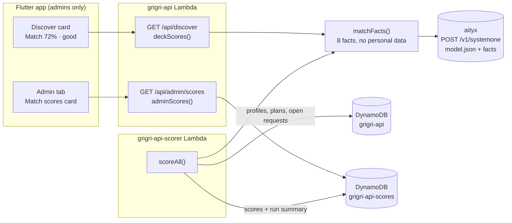

# Match scores with aityx: how it works

A developer's guide to Grigri's match scores: how likely a climber and a
plan end in a match (the climber asks to join and every member says yes),
worked out by a decision model that [aityx](https://aityx.ai) runs. The
normative behavior is in [specs/match-scores.md](../specs/match-scores.md);
this document walks through the code.

## In one picture



Two paths use the same model and the same facts:

1. **Live, on an admin's deck.** The API scores the deck's best 30 plans
   while it answers `GET /api/discover`.
2. **In bulk, on demand.** A separate function scores every profile
   against every upcoming plan and writes the scores table; the Admin
   tab previews its best 20.

Nobody but [admins](../specs/sign-in.md#admins) (rbacr's `admin` role in
the `grigri` system) sees a score, and the deck's order doesn't change.

## Why aityx, and why System One

aityx runs a portable JSON decision model on a case's facts. It has two
routes: **System One** runs the model on facts you already have,
deterministically, with no AI, for $0.042 per million input tokens;
**System Two** has an LLM read messy input (a message, a document) first.
The API knows every fact the model needs, so Grigri uses System One only:
same facts, same answer, about $0.00007 a call, and no personal data
leaves the API (no names, ages, bios or coordinates; only grades apart,
distance, group size and timing).

The score's weights are product judgements that will change. In the model
they're data, each table row with its reason (`# why`), and a change is an
edit to [model.json](../grigri_api/src/match/model.json), not to the code.

## Code map

### The model and the facts

| What | Where |
|---|---|
| The model's inputs: the 8 facts, each typed and described | [model.json](../grigri_api/src/match/model.json#L3) |
| `grade_fit`: grades overlap, short or over, as a first-match table | [model.json](../grigri_api/src/match/model.json#L38) |
| `nearness`: e^(−km/50), 0.25 when unknown | [model.json](../grigri_api/src/match/model.json#L55) |
| `crowding` and `timing`: other requests waiting, time to answer | [model.json](../grigri_api/src/match/model.json#L60), [#L70](../grigri_api/src/match/model.json#L70) |
| `group_odds`: 0.9 per member besides the organizer | [model.json](../grigri_api/src/match/model.json#L81) |
| `match_likelihood`: the product, to two decimals | [model.json](../grigri_api/src/match/model.json#L86) |
| `match_level` and `match_reason`: the answers the app shows | [model.json](../grigri_api/src/match/model.json#L91), [#L102](../grigri_api/src/match/model.json#L102) |
| `matchFacts()`: a climber and a plan to the model's facts (the distance is worked out here, with the deck's `distanceKm`) | [facts.ts](../grigri_api/src/match/facts.ts#L28) |

### Calling aityx

| What | Where |
|---|---|
| `aityxScorer()`: posts `{decision, state}` to `/v1/systemone` with the key; null without a key; any error, timeout or odd answer is null and logged without the key | [aityx.ts](../grigri_api/src/match/aityx.ts#L61) |
| `parseAnswers()`: reads `match_likelihood.number`, `match_level.level`, `match_reason.choice`; refuses anything unknown | [aityx.ts](../grigri_api/src/match/aityx.ts#L92) |
| `pooled()`: runs calls with bounded concurrency, keeping order | [aityx.ts](../grigri_api/src/match/aityx.ts#L118) |

### On an admin's deck

| What | Where |
|---|---|
| `discover()` asks for scores only when the caller is an admin | [api.ts](../grigri_api/src/api.ts#L353) |
| `deckScores()`: the best 30 plans, 10 calls at once, no new call after 4 s, never fails the deck | [api.ts](../grigri_api/src/api.ts#L363) (limits at [#L36](../grigri_api/src/api.ts#L36)) |
| The scorer built from `AITYX_URL` and `AITYX_API_KEY` | [handler.ts](../grigri_api/src/handler.ts#L108) |

### The scoring run and its table

| What | Where |
|---|---|
| The function's entry point: refuses without a key, runs, logs the summary | [scorer.ts](../grigri_api/src/scorer.ts#L21) |
| `scoreAll()`: every real profile × every upcoming plan it isn't in, the soonest plans first, capped at 5,000 pairs, 8 calls at once | [run.ts](../grigri_api/src/match/run.ts#L52) (demo climbers left out at [#L61](../grigri_api/src/match/run.ts#L61), the cap at [#L71](../grigri_api/src/match/run.ts#L71)) |
| `openByPlan()` / `othersWaiting()`: the requests waiting on each plan, the climber's own left out | [run.ts](../grigri_api/src/match/run.ts#L34) |
| `ScoresStore`: one score (GetItem), a run's best (Query on gsi1), the latest run, batch writes | [scores.ts](../grigri_api/src/store/scores.ts#L47) |
| `scoreItem()`: the item's keys, the best-first sort key, the TTL a day after the plan starts | [scores.ts](../grigri_api/src/store/scores.ts#L100) |
| `allClimbers()`: every profile, from the app table's gsi1 `CLIMBERS` partition | [store.ts](../grigri_api/src/store/store.ts#L142) |
| Profiles join that partition whenever they're saved | [store.ts](../grigri_api/src/store/store.ts#L538) |
| `adminScores()`, behind `GET /api/admin/scores` (admins only) | [api.ts](../grigri_api/src/api.ts#L598), route at [#L199](../grigri_api/src/api.ts#L199) |

### Infrastructure and deploy

| What | Where |
|---|---|
| `AityxApiKey` (NoEcho) and `AityxUrl` parameters | [template.yaml](../grigri_api/template.yaml#L65) |
| `ScoresTable`: on demand, gsi1, TTL, no backups (derived data) | [template.yaml](../grigri_api/template.yaml#L236) |
| The API's read-only access to it | [template.yaml](../grigri_api/template.yaml#L327) |
| `ScorerRole`: Query on the app table's gsi1, writes to the scores table only | [template.yaml](../grigri_api/template.yaml#L411) |
| `ScorerFunction`: 256 MB arm64, 15-minute timeout, invoked by hand | [template.yaml](../grigri_api/template.yaml#L449) |
| The key from the environment or `.env`, checked and passed | [deploy.sh](../scripts/deploy.sh#L161) |
| Running a scoring run | [score-matches.sh](../scripts/score-matches.sh) |
| Indexing older profiles, once per stage | [index-climbers.sh](../scripts/index-climbers.sh) |

### The app

| What | Where |
|---|---|
| `MatchScore`, `MatchLevel`, `MatchReason`, `ScoreRun`; unknown levels or reasons parse to no score | [match_score.dart](../grigri_app/lib/model/match_score.dart#L3) |
| Reading `scores` on the deck and the admin's preview | [api.dart](../grigri_app/lib/data/api.dart#L373), [#L379](../grigri_app/lib/data/api.dart#L379) |
| The store keeps the deck's scores and the preview | [grigri_store.dart](../grigri_app/lib/data/grigri_store.dart#L352), [#L643](../grigri_app/lib/data/grigri_store.dart#L643) |
| `MatchScoreTag`: "Match 72% · good" in the level's color, the reason beside it | [match_score.dart](../grigri_app/lib/ui/match_score.dart#L40) |
| On the Discover card, under the plan | [discover_screen.dart](../grigri_app/lib/ui/discover_screen.dart#L217) |
| The Admin tab's Match scores card and its rows | [admin_screen.dart](../grigri_app/lib/ui/admin_screen.dart#L58), [#L122](../grigri_app/lib/ui/admin_screen.dart#L122) |

## A worked example

A climber at grades 6a–6c (indices 6–10) sees a sport plan at 6b–7a
(8–11), 7 km away, with its organizer and one member, one other request
waiting, three days out. `matchFacts()` sends:

```json
{ "discipline_climbed": true, "grades_short": 0, "grades_over": 0,
  "distance_known": true, "distance_km": 7.1, "group_size": 2,
  "open_requests": 1, "days_until_start": 3 }
```

The model works out grade_fit 1 (the grades overlap), nearness
e^(−7.1/50) = 0.87, crowding 1, timing 1, group_odds 0.9, so
1 × (0.2 + 0.8 × 0.87) × 0.9 × 1 = **0.81**: level **great**, reason
**in grades and nearby**. (With model v1's 0.5 + 0.5 × nearness it was
0.84, which is what aityx production answered on 2026-10-16, for 1,570
input tokens.)

## Operating it

1. **The key.** Put `GRIGRI_AITYX_API_KEY=aityx_sk_…` in the private
   `.env` (setec-astronomy's `grigri.nu01/.env`) and in the repository
   secret of the same name, then deploy. A stage key also needs
   `GRIGRI_AITYX_URL` (aityx's stage). Without a key nothing breaks: there
   are just no scores.
2. **Older profiles, once per stage:**
   `STAGE=prod bash scripts/index-climbers.sh` (an administrator's
   credentials: it scans the table).
3. **A scoring run:** `STAGE=prod bash scripts/score-matches.sh`. It
   prints the run's summary; the Admin tab shows it on its next refresh.

Nothing schedules runs. The deploy roles and the functions' permissions
boundary ([grigri_infra/github-deploy.yaml](../grigri_infra/github-deploy.yaml))
allow neither EventBridge schedules nor one function invoking another, so
a schedule needs that stack changed by its administrator first.

## Changing the model

1. Edit [model.json](../grigri_api/src/match/model.json). Keep aityx's
   strict mode: every input and decision has a `type` and a `desc`, every
   table ends with an else row (`-` in every input cell) and every row has
   a `# why`. The unit test checks these
   ([match.test.ts](../grigri_api/test/match.test.ts)).
2. Run the same facts through the old and the new model to see what
   changes (aityx's console replays them, or post both to
   `/v1/systemone`).
3. A new level or reason also needs the API's lists
   ([aityx.ts](../grigri_api/src/match/aityx.ts)), the app's enums
   ([match_score.dart](../grigri_app/lib/model/match_score.dart)) and the
   labels in every language (`grigri_app/lib/l10n/app_*.arb`); until then
   the app shows no score rather than a wrong one.

## Tests

- API: [match.test.ts](../grigri_api/test/match.test.ts): the facts, the
  model's shape against the facts and strict mode, parsing, the client
  (key, body, errors without the key in logs), the run (pairs, cap,
  failures, waiting requests), the table's keys, and the routes (admins
  only, best effort). `npm test` in `grigri_api/`.
- App: the deck's score for admins and nobody else, the Admin tab's
  preview, and the JSON shapes
  ([widget_test.dart](../grigri_app/test/widget_test.dart),
  [api_test.dart](../grigri_app/test/api_test.dart)). `flutter test` in
  `grigri_app/`.

## Cost

| | |
|---|---|
| One score | ~1,600 input tokens, about $0.00007 (output is free) |
| An admin's deck | up to 30 scores, about $0.002 |
| A full run | at most 5,000 scores, about $0.33, plus 5,000 table writes (~$0.006) and a few minutes of a 256 MB Lambda |
| Idle | $0 |

## Limits and next steps

- aityx is a tech preview with no SLA; that's why every call is best
  effort and the deck never waits on it for long.
- The model travels with every call (aityx stores none), which is most
  of each call's tokens.
- The weights are a first guess. Requests already record what happened
  (accepted, declined), so a later step can compare scores with outcomes
  and tune the model.
- **System Two**, later: plan notes and bios are free text ("need a lead
  belayer", "have a rope"). Reading them once when a plan or profile is
  saved, into a few structured facts, would let the model weigh gear and
  roles too, at System Two's price only on writes.
